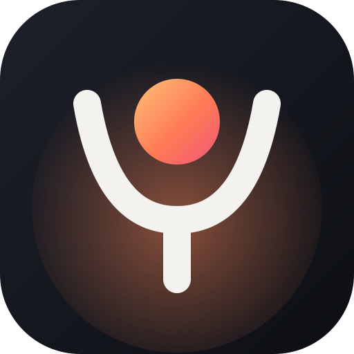

<h1 align="center">Luma</h1>

<i>powered by Lumerya Solution</i> <b>Sport et soin de soi, à votre rythme.</b>

👉 <a href="https://illynetwork-blip.github.io/luma/"><b>Ouvrir Luma</b></a>

---

**Un défi de 28 jours conçu à partir de vos réponses**, sur téléphone, tablette et ordinateur. S'installe comme une application (Partager → Sur l'écran d'accueil).

- **Questionnaire** : profil, activité, mode de vie, soin de soi, alimentation, mensurations.
- **Votre plan** : profil bien-être, projection prudente, programme adapté à votre niveau et à vos gênes.
- **Séances guidées** de 15 à 26 minutes, sans matériel, avec minuteur et versions plus douces.
- **Repas** selon votre façon de manger, liste de courses de la semaine.
- **Soin de soi** : respiration guidée, méditation, journal, routine du soir.
- **Progrès** : poids, séances, eau, sommeil, humeur.

Vos données de santé restent **sur votre appareil**. Photos : Unsplash (licence Unsplash). Vidéos de démonstration : Pexels (licence Pexels).

Ce dépôt contient le site construit. Les sources sont dans le dépôt privé `luma-sources`.
